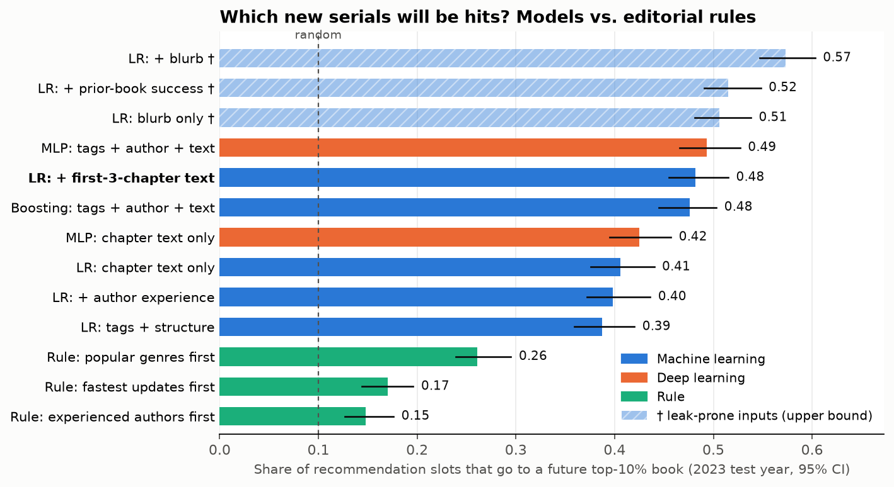

# Royal Road Breakout

MIT 15.071 *The AI Edge*, Fall 2026, Project 1 (predictive AI).

**Question.** A web-fiction platform has a fixed number of recommendation slots and thousands of new serials every quarter. Given only what exists when chapter 3 is published (the first three chapters, the tags, and whether the author has written before), can we predict which serials will end up in the **top 10% of followers among books released in the same quarter**? We care most about **debut authors**, who have no track record to fall back on.

**Result.** On 2023 serials (held out in time), a logistic regression on tags, author experience and an embedding of the first three chapters puts **48% of recommendation slots on a future top-10% book**, against 26% for the best editorial rule and 10% at random. Details in [`modeling/README.md`](modeling/README.md).

**Interactive atlas.** <https://godspeedhuang.github.io/royalroad-breakout/> (served by GitHub Pages from `docs/`): 45,245 books placed by the embedding of their first three chapters, in a PCA view and a UMAP view.

## Data

[OmniAICreator/RoyalRoad-1.61M](https://huggingface.co/datasets/OmniAICreator/RoyalRoad-1.61M) on Hugging Face: 1.61M chapters from 86,959 serials on royalroad.com, one row per chapter, 12 GB.

Things that shaped the design:

- Popularity fields (`followers`, `total_views`) are a **single snapshot** (about 2025-06-16), identical on every chapter row of a book. There is no growth curve.
- Older books have had more time to collect followers, so the target is **cohort-relative**: rank within the release quarter.
- The five score columns are entirely null.
- Sample used here: books first released 2016–2024 with at least 3 chapters → **45,245 books**, 10.0% positive.

## Layout

| Path | What |
|---|---|
| `docs/project-brief.md` | Course requirements for Project 1 (zh-TW summary) |
| `eda/01_eda.ipynb` | EDA on the raw dataset; writes `data/interim/` and `reports/eda/` |
| `embedding/01–03` | Select books, embed the first three chapters, pool to one vector per book, project to 2D |
| `embedding/04–12` | Tag trends, embedding drift, watermark check, direction explanation |
| `embedding/06, 08, 13` | Launch the atlas locally; export the public static atlas to `docs/atlas/` |
| `embedding/out/` | Small results (JSON, CSV, figures) are tracked; parquet files are not |
| `modeling/` | Rule baselines, logistic regression, gradient boosting, PyTorch MLP, drift test; results in `modeling/out/` |
| `reports/` | EDA figures and HTML report sources |

## Reproduce

Requires [uv](https://docs.astral.sh/uv/) and about 20 GB of disk.

```bash
uv sync
uv run hf download OmniAICreator/RoyalRoad-1.61M --repo-type dataset --local-dir data/raw

# EDA; also writes data/interim/{chapters,fictions}_47.parquet used by the next step
uv run jupyter nbconvert --to notebook --execute --inplace eda/01_eda.ipynb

# Embeddings: needs an OpenAI-compatible endpoint
cp embedding/.env.example embedding/.env      # then fill in the key and base URL
uv run python embedding/01_prepare.py         # 45,245 books → 183,020 chunks, ~355M tokens
uv run python embedding/02_embed.py           # text-embedding-3-small, 1,536-d; resumable
uv run python embedding/03_pool_project.py    # → out/books.parquet, chapters.parquet, atlas.parquet

# Analysis (each writes to embedding/out/)
uv run jupyter nbconvert --to notebook --execute --inplace embedding/04_tags_trend.ipynb embedding/05_drift.ipynb
uv run python embedding/07_atlas_pca.py
uv run python embedding/09_pca_trajectory.py
uv run python embedding/10_tags_compare.py
uv run python embedding/11_watermark_check.py
uv run python embedding/12_explain_direction.py   # calls the embedding endpoint for 18 probe sentences

# Atlas
./embedding/06_atlas.sh          # UMAP view, http://localhost:5055
./embedding/08_atlas_pca.sh      # PCA view with quarterly centroids, http://localhost:5057
./embedding/13_export_atlas.sh   # rebuild docs/atlas/

# Models (about 3 minutes on a laptop CPU; needs embedding/out/books.parquet)
cd modeling
uv run python features.py     # self-check of splits, author history and metrics
uv run python 01_ml.py        # rules, logistic regression, gradient boosting
uv run python 02_dl.py        # MLP on the frozen embeddings
uv run python 03_compare.py   # → out/results.json, results.md, figs/model_comparison.png
uv run python 04_drift.py     # → out/drift_auc.json, figs/drift_auc.png
```

## Large files

Git keeps the folder skeleton (`.gitkeep`) but not the data. The interactive atlas does **not** need any of this: its data (`docs/atlas/*/data/dataset.parquet`, 34 MB each) is committed so GitHub Pages can serve it.

Only the embeddings cost money to rebuild (paid API calls, about 40 minutes), so they are published as a public Hugging Face dataset: **[`syuanbo/royalroad-breakout`](https://huggingface.co/datasets/syuanbo/royalroad-breakout)**. It mirrors this repo's paths, so from the repo root:

```bash
uv run hf download syuanbo/royalroad-breakout --repo-type dataset --include "embedding/*" --local-dir .
```

| File | Size | Needed for |
|---|---|---|
| `embedding/out/books.parquet` | 826 MB | **Modeling** (`modeling/`). One row per book: features, `top10`, `book_vec` / `chap1_vec` / `desc_vec` (1,536-d) |
| `embedding/out/books_meta.parquet` | 28 MB | Tag analyses (`embedding/04`, `10`) |
| `embedding/out/atlas.parquet`, `atlas_pca.parquet` | 78 MB each | Local atlas (`06`, `08`) and re-exporting `docs/atlas/` (`13`) |

Everything else is free to rebuild from the upstream dataset: `data/raw/` (12 GB, `hf download` above), then `eda/01_eda.ipynb` → `data/interim/`, then `embedding/01_prepare.py` → `chapters_meta.parquet` (needed by `11`, `12`). The Hugging Face upload is done by `embedding/14_publish_hf.sh`.

## How the embedding works

1. Take chapters 1–3 in release order; cap each book at 20,000 tokens (`cl100k_base`).
2. One vector per chapter. Chapters over 8,000 tokens are split evenly at paragraph boundaries, embedded, and recombined by token-weighted mean.
3. Book vector = token-weighted mean of the three chapter vectors, L2-normalised. The blurb gets its own vector.
4. 2D views: PCA (fit on all years together; PC1+PC2 = 10.4% of variance) and UMAP on the first 50 PCs.

## Model results

Train 2017–2021, tune on 2022, test once on 2023 (8,075 books, 811 positives). "Recall@slots" gives each quarter as many slots as it has true top-10% books and reports the share of slots that hit one.

| Model | AUC | Recall@slots (95% CI) |
|---|---|---|
| Random | 0.50 | 0.10 |
| Best rule: popular genres first | 0.742 | 0.261 (0.239–0.295) |
| LR: tags + structure | 0.810 | 0.387 (0.359–0.420) |
| **LR: + author experience + first-3-chapter text (main)** | **0.887** | **0.482 (0.455–0.515)** |
| Gradient boosting, same features | 0.865 | 0.476 (0.445–0.503) |
| MLP on frozen embeddings, same features | 0.886 | 0.493 (0.466–0.527) |



- **Chapter text adds +8.4 pp** of recall over tags and author experience (95% CI +4.8 to +11.2). Boosting and the MLP are not distinguishable from logistic regression, so the simple model is the main one.
- **Impact.** With about 203 slots per quarter in 2023, the model surfaces 98 future hits per quarter versus 53 for the best rule and 20 at random.
- **First-time authors** (two thirds of books) are harder: recall 0.43, still well above the rule's 0.25.
- **Blurbs are excluded on purpose.** The blurb is the 2025 version, and 7.8% of test books have blurbs mentioning Amazon, Kindle, Patreon, Audible or a second volume; 46% of those are hits. Adding the blurb lifts recall to 0.57, but that is an upper bound contaminated by edits made after success.
- **Retraining.** Holding the test year fixed, each extra year of age in the training window costs 0.026 AUC for a tags-only model and 0.008 for a text-only model. Retrain at least yearly.

## Exploratory findings

- **Tags.** LitRPG's lift (share among top-10% ÷ share among all books) rose from 1.6 (2017–19) to 2.5 (2022–24); Romance fell from 0.96 to 0.66.
- **Watermarks.** About 6,500 books contain anti-piracy sentences inserted into chapter text (they mention Amazon or Royal Road), including 75% of 2016 books. This alone produced an apparent 2016→2017 jump in the embedding space. The models train on 2017 onward, and dropping watermarked books from the test year leaves the main model's AUC unchanged (0.889 vs 0.887).
- **Preference drift is small.** After excluding watermarked books, the "what top-10% books have that others don't" direction keeps a cosine similarity of 0.94 across 8 years.
- **What moved.** Supply shifted away from game-system and reincarnation stories; top-10% books mostly moved with the market. Net of supply, preference moved slightly toward fantasy adventure and away from romance.

The exploratory findings are descriptive and correlational. 2024 books have had under 18 months to accumulate followers, so 2024 scores are reported only as a secondary check.

## Notes on the data

- The dataset card lists the licence as MIT; the chapter text itself belongs to its authors. This repository contains no full chapter text. The public atlas shows a 300-character excerpt per book with a link to the source, and no author names.
