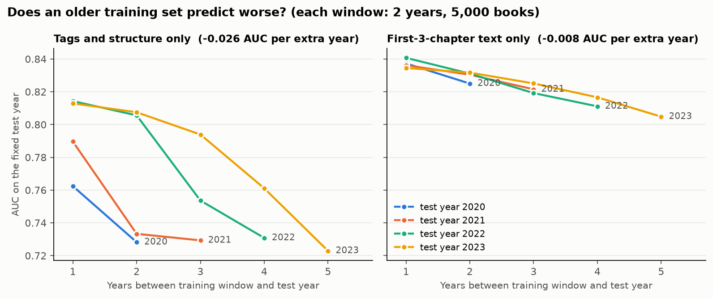

# modeling

Project 1 的主模型：規則 baseline → machine learning → deep learning，加上口味漂移測試。

## 怎麼跑

需要 `embedding/out/books.parquet` 和 `embedding/out/watermark_books.csv`。全部跑完約 3 分鐘（Mac，CPU）。

```bash
cd modeling
uv run python features.py     # 自我檢查：切分大小、作者歷史沒偷看、指標算得對
uv run python 01_ml.py        # 規則、logistic regression、gradient boosting
uv run python 02_dl.py        # PyTorch MLP
uv run python 03_compare.py   # 比較、信賴區間、分組、leak 檢查、影響換算
uv run python 04_drift.py     # 固定測試年，換訓練年代
uv run python 05_experiments.py   # 驗證年實驗：想改進主模型的嘗試（約 6 分鐘，需要 chapters.parquet）
uv run python 06_day30.py     # 第 30 天版本：主模型 + 前 30 天更新節奏（需要 data/interim/chapters_47.parquet 和 data/raw）
uv run python 07_impact.py    # 商業影響：每季固定版位下的命中率與金額（需要 01、02、06 的預測）
```

| 檔案 | 產出 |
|---|---|
| `features.py` | 共用：特徵區塊、時間切分、指標 |
| `01_ml.py`、`02_dl.py` | `out/preds_*.parquet`（每本書每個模型的分數，不進 git）、`out/selection_*.json`（選到的超參數與驗證分數） |
| `03_compare.py` | `out/results.json`、`out/results.md`、`out/figs/model_comparison.png` |
| `04_drift.py` | `out/drift_auc.json`、`out/figs/drift_auc.png` |
| `05_experiments.py` | `out/experiments_val.json`（文風特徵快取在 `out/style_trainval.parquet`，不進 git） |
| `06_day30.py` | `out/day30.json`、`out/preds_day30.parquet`（不進 git） |
| `07_impact.py` | `out/impact.json`（簡報與影片的數字都從這裡讀） |

## 設計

- **單位**：一本書一列。資料來源 `embedding/out/books.parquet`（45,245 本，2016–2024 年開始連載、至少 3 章）。
- **Y**：`top10`，同一季開始連載的書裡 followers 是否 ≥ 90 百分位。只跟同季比，是為了消掉「連載越久 followers 越多」。
- **切分（依時間）**：

| | 年份 | 本數 | 用途 |
|---|---|---|---|
| train | 2017–2021 | 17,100 | 訓練 |
| val | 2022 | 5,700 | 選超參數、選主模型 |
| test | 2023 | 8,075 | 只在最後打一次分數 |
| recent | 2024 | 12,165 | 補充。觀察時間只有 0.5–1.5 年，「前 10%」還不穩 |

  2016 年不用（75% 的書含浮水印）。選好超參數後用 2017–2022 重新訓練，再打 2023 和 2024。同一位作者的舊書在 train、新書在 test 是允許的，上線時本來就看得到作者以前的書。

- **指標**：AUC、AP、**Recall@名額**。每一季的推薦名額 = 該季熱門書的數量（約 10%，2023 年每季約 203 個），看這些名額有多少比例給到了真正的熱門書。隨機挑是 0.10。
- **特徵區塊**（代號用在模型名稱裡，例如 `lr_SAT`）：

| 代號 | 內容 | 維度 | 可以用嗎 |
|---|---|---|---|
| S | tags、warnings、`is_original`、前三章長度與發布間隔 | 75 | 可以 |
| A | 作者經驗：是不是第一次寫書、以前寫過幾本 | 2 | 可以 |
| T | 前三章向量 `book_vec` | 1,536 | 可以 |
| P | 前作有沒有進同季前 10% | 1 | **有 leak 疑慮**。前作的 followers 是 2025 年快照，這本書紅了會回頭拉高前作 |
| D | 簡介向量 `desc_vec` + 簡介長度 | 1,537 | **有 leak 疑慮**。簡介是 2025 年的版本，見下面 |

  不能當特徵（事後才有）：`followers`、`total_views`、`average_views`、`favorites`、`ratings`、`n_chapters`、`pct_in_quarter`、`log_followers`、`status`、`cover_url`。前作的 followers 原始數字也不用。

- **主模型**不是看測試分數選的：從沒有 leak 疑慮的三個候選（`lr_SAT`、`gb_SAT`、`mlp_SAT`）裡挑驗證年 AUC 最高的，結果是 `lr_SAT`。

## 結果（測試年 2023，8,075 本，811 本熱門）


| 模型 | AUC | Recall@名額（95% CI） | 2024 |
|---|---|---|---|
| 規則：更新最快的優先 | 0.625 | 0.170（0.144–0.196） | 0.195 |
| 規則：老作者優先 | 0.565 | 0.148（0.127–0.176） | 0.177 |
| 規則：熱門類型優先 | 0.742 | 0.261（0.239–0.295） | 0.282 |
| LR：S | 0.810 | 0.387（0.359–0.420） | 0.405 |
| LR：S+A | 0.814 | 0.398（0.372–0.436） | 0.414 |
| **LR：S+A+T（主模型）** | **0.887** | **0.482（0.455–0.515）** | 0.453 |
| Gradient boosting：S+A+T | 0.865 | 0.476（0.445–0.503） | 0.470 |
| MLP：S+A+T | 0.886 | 0.493（0.466–0.527） | 0.456 |
| LR：只用 T | 0.856 | 0.406（0.376–0.440） | 0.377 |
| MLP：只用 T | 0.858 | 0.425（0.395–0.457） | 0.388 |
| LR：S+A+T+P † | 0.896 | 0.515（0.491–0.548） | 0.490 |
| LR：S+A+T+P+D † | 0.918 | 0.573（0.547–0.603） | 0.566 |
| LR：只用 D † | 0.873 | 0.506（0.481–0.538） | 0.491 |

† 有 leak 疑慮，只當上限參考。完整數字在 `out/results.json`。

**每一步多了多少**（Recall@名額，百分點，成對 bootstrap 95% CI）：

| 比較 | 差 | 95% CI | 結論 |
|---|---|---|---|
| 主模型 vs 最好的規則 | +22.1 | +18.2 到 +25.3 | 模型明顯比規則好 |
| 加作者經驗（S → S+A） | +1.1 | −0.2 到 +3.0 | 不顯著 |
| 加前三章文字（S+A → S+A+T） | +8.4 | +4.8 到 +11.2 | 顯著，文字有用 |
| Gradient boosting vs LR | −0.6 | −3.8 到 +1.8 | 沒差 |
| MLP vs LR | +1.1 | −0.8 到 +2.8 | 沒差 |
| 加前作表現（† P） | +3.3 | +1.5 到 +5.5 | 顯著，但有 leak 疑慮 |
| 加簡介（† D） | +5.8 | +3.2 到 +8.5 | 顯著，但有 leak 疑慮 |

**分組**（主模型 `lr_SAT`）：

| 組別 | 本數 | AUC | Recall@名額 | 最好的規則 |
|---|---|---|---|---|
| 全部 | 8,075 | 0.887 | 0.482 | 0.261 |
| 第一次寫書的作者 | 5,383 | 0.878 | 0.430 | 0.246 |
| 有前作的作者 | 2,692 | 0.894 | 0.536 | 0.317 |

第一次寫書的作者比較難猜，但模型還是比規則好很多。

**影響換算**（2023 年平均每季約 2,019 本新書、203 個名額）：

| 排法 | 每季挑中的熱門書 | 被推薦的書最後累積的 followers |
|---|---|---|
| 隨機 | 20 | 約 4.2 萬 |
| 熱門類型優先 | 53 | 約 11.8 萬 |
| 主模型 | 98 | 約 23.8 萬 |
| 完美預測 | 203 | 約 37.2 萬 |

followers 是事後數字，只用來表達「推薦位有沒有給對書」，不是推薦造成的增量。

**沒命中的版位給了誰**（`05_experiments.py` 第 6 部分，只描述、不拿來選模型）：主模型的版位有 48.2% 給了同季前 10% 的書、67.4% 給了前 20%；沒命中的那些書，中位數排在同季第 76 百分位。熱門類型優先的規則分別是 26.1%、42.5%、第 65 百分位；隨機挑是 10%、20%、第 50 百分位。

## 第 30 天版本（`06_day30.py`）

給推薦團隊的第二輪篩選：第 3 章先推一批，第一章發布後第 30 天再用更新節奏重排。特徵是主模型的 S+A+T，再加 V：第一天、前 7 天、前 30 天各發幾章，前 30 天有幾天有更新，最長斷更幾天，第 30 天時離上次更新幾天，前 30 天總字數。V 只用前 30 天發布的章節（來源 `data/interim/chapters_47.parquet`），在第 30 天都看得到。

訓練年和驗證年裡，熱門書前 30 天中位數發了 15 章，其他書 6 章。

| | 第 3 章（`lr_SAT`） | 第 30 天（S+A+T+V） | 差（百分點，成對 bootstrap 95% CI） |
|---|---|---|---|
| 驗證年 2022，Recall@名額 | 0.454 | 0.506 | |
| 測試年 2023，全部 | 0.482 | 0.490 | +0.7（−2.0 到 +3.1），不顯著 |
| 測試年 2023，第一次寫書 | 0.430 | 0.455 | +2.4（−1.1 到 +6.4），不顯著 |
| 2024，全部 | 0.453 | 0.516 | |
| 2024，第一次寫書 | 0.383 | 0.464 | |

驗證年看起來有用（+5.2），到了測試年 2023 只剩 +0.7。2024 年又多了 6.3，但 2024 年的書觀察時間最短（0.5–1.5 年），followers 還很接近「開張頭幾個月的熱度」，更新節奏本來就會跟它很像，所以 2024 的提升可能高估。結論：當成第二輪的確認，上線前要做 A/B test，不取代第 3 章的主模型。

「完整作者歷史」（F：用全部書重算，含不到 3 章就停的前作和 2016 年以前的書）只在驗證年比過：Recall@名額 0.454 → 0.462，第一次寫書那組沒變。原本被標成「第一次寫書」的作者，有 5.3% 其實寫過（前作不到 3 章或在 2016 年以前），影響很小，不採用。

已知風險：書紅了以後把後面章節下架（stubbed）通常保留前面幾十章，前 30 天大多還在，影響偏保守；沒紅的作者刪章會讓節奏看起來比實際差，這個資料集查不到。上線後要防作者把一章拆成好幾章灌數字，所以特徵裡有字數。

## 商業影響（`07_impact.py`）

簡報用的版本：每季固定 50 個推薦版位（對應 Rising Stars 每個類型最多 50 本），每季挑分數最高的 50 本。和上面的 Recall@名額不同，那邊名額 = 該季熱門書數（2023 年約 203 個）。所有假設都在 `07_impact.py` 最上面，改完重跑 07 和 `reports/slides/build_deck.js`。

2023 測試年，每季 50 個版位：

| 排法 | 版位命中率（95% CI） | 每季挑中的熱門書 |
|---|---|---|
| 隨機 | 10% | 5 |
| 規則：熱門類型優先 | 28%（22%–35%） | 14 |
| LR：S+A | 53%（46%–60%） | |
| **LR：S+A+T（主模型）** | **68%（61%–75%）** | **34** |
| Gradient boosting：S+A+T | 71%（63%–77%） | |
| MLP：S+A+T | 74%（65%–78%） | |

加前三章文字 +15.5 點（CI +7.5 到 +23.5）；MLP 比 LR +5.5（CI −2.0 到 +9.8）、boosting +3.0，在 2023 都不顯著，所以主模型維持 LR。事後把 2024 也併進來（8 季）再看一次：MLP +6.2（CI +1.0 到 +9.3），boosting +5.2（CI −0.7 到 +10.1）。MLP 在名單最前段可能真的多幾個點，但 2024 標籤還沒成熟、這個比較是看完結果才做的，所以只當「每年重訓時再比一次」的理由（`impact.json` 的 `diff_pp_2023_2024`）。名額越少，模型和規則差越多：每季 25 個版位時，版位上的書累積瀏覽量是規則的 7.7 倍，50 個 5.5 倍，200 個 2.3 倍，400 個 1.7 倍。

金額（base case：上推薦位讓那本書的瀏覽量多 10%，每千次瀏覽 $3 廣告收入）：模型的版位每年多帶來約 1,300 萬次瀏覽、約 $3.9 萬；lift 5–20%、CPM $2–5 的範圍是 $1.3 萬到 $13 萬。只算「同樣的版位給對書」，不含讀者因此留下來多看別本，偏保守。2023 年同季前 10% 的書拿走 86% 的總瀏覽量，這也是用前 10% 定義「熱門」的理由。

補充：編輯每篩一本 10 分鐘、有模型後每季只讀前 200 名，一年省約 1,200 小時（時薪 $30 約 $3.6 萬）。這是「讓人工把關變得做得到」，不是 Royal Road 現在真的有在花的錢。

`impact.json` 也列出影片開場用的例子：2023 年新作者、後來進前 10%、第 3 章時模型就排進當季前 50 名的書（第一名是 "Reborn as a Demonic Tree"，2023Q1 在 1,775 本裡排第 31，現在 15,595 個 followers）。

## 口味漂移（`04_drift.py`）



固定測試年，換不同年代的訓練資料（每個訓練窗 2 年、抽 5,000 本）。同一個測試年內，訓練資料每多舊一年：

- 只用 tags 等結構化特徵：AUC 掉 0.026。
- 只用前三章文字：AUC 掉 0.008。

意思是：tags 的規則老得快，文字的訊號比較耐用。tags 掉得快有一部分是標籤系統本身在變（例如 Progression 這個 tag 是後來才普及的），不全是讀者口味變了。給推薦團隊的建議：模型至少每年重訓一次。

## Leak 檢查

- **簡介（D）有問題。** 測試年 7.8% 的書，簡介裡有 Amazon、Kindle、Patreon、Audible、"Book 2"、Discord 這類字。這些書有 45.5% 是熱門書（整體是 10%），光用這個旗標 AUC 就有 0.652。這些字多半是作者紅了之後才加的，所以 D 不放進主模型。只用簡介的模型拿掉這些書後 AUC 從 0.873 掉到 0.837。
- **浮水印對模型沒影響。** 測試年 9.7% 的書含浮水印，其中 11.1% 是熱門書（和整體差不多），旗標本身 AUC 0.506。拿掉這些書後主模型 AUC 0.889（原本 0.887）。所以不需要為了建模重做 embedding。
- **還沒排除的**：tags 和章節內容也是 2025 年的版本，作者可能事後改過（補 tag、在章節裡加作者留言）。這個資料集沒辦法還原當時的版本。

## 驗證年實驗（`05_experiments.py`，2026-11-16）

想讓主模型更好的嘗試。**全部只在 2022 驗證年比較**（2017–2021 訓練），測試年 2023 沒有碰，所以這些數字不能跟上面的測試年結果直接比。2022 年有 571 本熱門書，命中率的標準誤差約 0.02，差距比這小的都當成沒差。完整數字在 `out/experiments_val.json`。

基準是主模型 `lr_SAT`：驗證年 AUC 0.8775、Recall@名額 0.454。

| 嘗試 | 做法 | 驗證年 AUC | Recall@名額 | 結論 |
|---|---|---|---|---|
| 換更大的 embedding | 只取 `book_vec` 前 k 維當作較小的模型（v3 embedding 可以截短），看維度的邊際效益。只用文字：512 維 0.839、1,024 維 0.846、1,536 維 0.849 | | | 邊際效益已經很小，推估換 `text-embedding-3-large`（3,072 維，貴 6.5 倍）只會多約 0.005–0.015 AUC，沒做 |
| 三章並列 | 三章向量各自當特徵（3 × 1,536 = 4,608 欄），取代平均 | 0.869 | 0.427 | 變差。欄位變三倍、正則化要更強，三章各自的差異多半是雜訊 |
| 只用第一章 | 第一章向量取代前三章平均 | 0.867 | 0.431 | 變差。只用文字時第 1、2、3 章各約 0.82，三章平均 0.85 |
| 第一章加在前三章旁邊 | S+A+T+第一章 | 0.875 | 0.450 | 沒差 |
| **三章等權平均** | 三章向量直接平均（現在是依 token 數加權） | **0.881** | **0.461** | 唯一小贏，在每個 C 都比較好。加權時很長的那一章會主導整本書的向量 |
| 鄰居特徵（kNN） | 找最像的 50 本「早至少 365 天、不同作者」的書，算進前 10% 的比例、平均排名、加權比例 | 0.878 | 0.457 | 沒差。單獨用有訊號（AUC 0.756；S+A+鄰居 0.843），但 T 已經涵蓋 |
| 文風統計 | 前三章原文的 17 個統計（句長、段落長、對話佔比、`[ ]` 面板、小寫 i、破折號、-ly 副詞、詞彙豐富度等） | 0.877 | 0.452 | 沒差。單獨 AUC 0.660，加在 S+A 上有幫助（0.818 → 0.826），加在主模型上沒有 |
| 連續目標 | Ridge 猜同季排名 `pct_in_quarter`，取代猜 0/1 | 0.861 | 0.431 | 變差。模型被迫去分辨版位用不到的中下段 |
| Ridge 猜 0/1 | 對照組：只把 log loss 換成平方誤差 | 0.875 | 0.457 | 沒差 |
| 排序 loss（紅 vs 沒紅） | 同一季內配對一本紅的、一本沒紅的，LR 學哪本排前面（RankNet 的線性版），3 組隨機配對平均 | 0.875 | 0.467 | 命中率 +1.3 個百分點但在雜訊內（三次 0.457–0.475），AUC 略低，不換 |
| 排序 loss（依排名） | 同季排名差 ≥ 0.2 的兩本配對 | 0.854 | 0.410 | 變差，原因同連續目標 |

文風統計裡單獨最有關的：破折號用得多（AUC 0.605）、-ly 副詞多（0.586）、`[ ]` 遊戲面板多（0.581），小寫 i 多的書比較不會紅（0.468）。

**結論**：主模型在現有資訊下已經接近上限。加維度、拆章節、鄰居、文風都被前三章向量涵蓋了；改目標或 loss 也沒有穩定的進步。唯一可以採用的是三章等權平均（AUC +0.003，命中率 +0.7 個百分點，都在雜訊內），還沒改進主模型。要再往上，要換一種資訊來源（LLM 評分開頭、fine-tune 文字模型）。

## 已知限制

- DL 這邊文字編碼器是凍結的，只訓練接在向量後面的 MLP，結果和 LR 沒有差別。要再往上要 fine-tune 文字模型（`chapters.parquet` 有原文），成本高一個量級。
- 作者經驗只算樣本內的書（2016–2024、至少 3 章），更早的或不到 3 章的前作沒算進來。
- 隊友先前的版本（2021–2023、至少 5 章、13,998 本）報的 Recall@10% 約 50%，其中有用標題和簡介。這裡不用簡介是 48%，用了是 57%，量級一致，但樣本和切分不同，不能直接比。
- 2016–2017 年每季前 10% 只有 52–60 本；followers 為 0 的書在同季排名並列。
