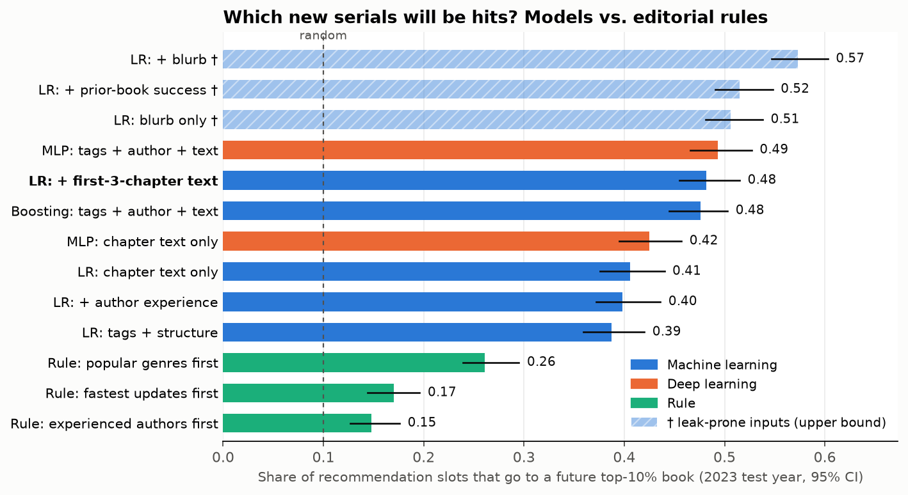
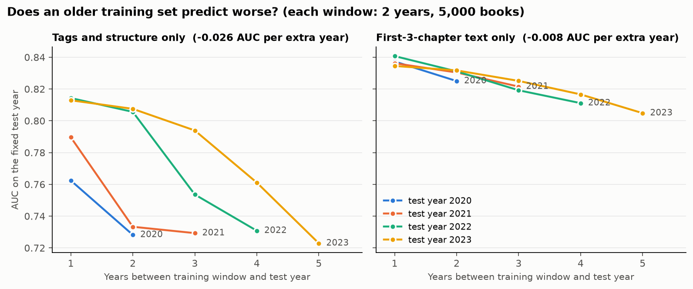

# modeling

Project 1 的主模型：規則 baseline → machine learning → deep learning，加上口味漂移測試。

## 怎麼跑

需要 `embedding/out/books.parquet` 和 `embedding/out/watermark_books.csv`。全部跑完約 3 分鐘（Mac，CPU）。

```bash
cd modeling
uv run python features.py     # 自我檢查：切分大小、作者歷史沒偷看、指標算得對
uv run python 01_ml.py        # 規則、logistic regression、gradient boosting
uv run python 02_dl.py        # PyTorch MLP
uv run python 03_compare.py   # 比較、信賴區間、分組、leak 檢查、影響換算
uv run python 04_drift.py     # 固定測試年，換訓練年代
```

| 檔案 | 產出 |
|---|---|
| `features.py` | 共用：特徵區塊、時間切分、指標 |
| `01_ml.py`、`02_dl.py` | `out/preds_*.parquet`（每本書每個模型的分數，不進 git）、`out/selection_*.json`（選到的超參數與驗證分數） |
| `03_compare.py` | `out/results.json`、`out/results.md`、`out/figs/model_comparison.png` |
| `04_drift.py` | `out/drift_auc.json`、`out/figs/drift_auc.png` |

## 設計

- **單位**：一本書一列。資料來源 `embedding/out/books.parquet`（45,245 本，2016–2024 年開始連載、至少 3 章）。
- **Y**：`top10`，同一季開始連載的書裡 followers 是否 ≥ 90 百分位。只跟同季比，是為了消掉「連載越久 followers 越多」。
- **切分（依時間）**：

| | 年份 | 本數 | 用途 |
|---|---|---|---|
| train | 2017–2021 | 17,100 | 訓練 |
| val | 2022 | 5,700 | 選超參數、選主模型 |
| test | 2023 | 8,075 | 只在最後打一次分數 |
| recent | 2024 | 12,165 | 補充。觀察時間只有 0.5–1.5 年，「前 10%」還不穩 |

  2016 年不用（75% 的書含浮水印）。選好超參數後用 2017–2022 重新訓練，再打 2023 和 2024。同一位作者的舊書在 train、新書在 test 是允許的，上線時本來就看得到作者以前的書。

- **指標**：AUC、AP、**Recall@名額**。每一季的推薦名額 = 該季熱門書的數量（約 10%，2023 年每季約 203 個），看這些名額有多少比例給到了真正的熱門書。隨機挑是 0.10。
- **特徵區塊**（代號用在模型名稱裡，例如 `lr_SAT`）：

| 代號 | 內容 | 維度 | 可以用嗎 |
|---|---|---|---|
| S | tags、warnings、`is_original`、前三章長度與發布間隔 | 75 | 可以 |
| A | 作者經驗：是不是第一次寫書、以前寫過幾本 | 2 | 可以 |
| T | 前三章向量 `book_vec` | 1,536 | 可以 |
| P | 前作有沒有進同季前 10% | 1 | **有 leak 疑慮**。前作的 followers 是 2025 年快照，這本書紅了會回頭拉高前作 |
| D | 簡介向量 `desc_vec` + 簡介長度 | 1,537 | **有 leak 疑慮**。簡介是 2025 年的版本，見下面 |

  不能當特徵（事後才有）：`followers`、`total_views`、`average_views`、`favorites`、`ratings`、`n_chapters`、`pct_in_quarter`、`log_followers`、`status`、`cover_url`。前作的 followers 原始數字也不用。

- **主模型**不是看測試分數選的：從沒有 leak 疑慮的三個候選（`lr_SAT`、`gb_SAT`、`mlp_SAT`）裡挑驗證年 AUC 最高的，結果是 `lr_SAT`。

## 結果（測試年 2023，8,075 本，811 本熱門）



| 模型 | AUC | Recall@名額（95% CI） | 2024 |
|---|---|---|---|
| 規則：更新最快的優先 | 0.625 | 0.170（0.144–0.196） | 0.195 |
| 規則：老作者優先 | 0.565 | 0.148（0.127–0.176） | 0.177 |
| 規則：熱門類型優先 | 0.742 | 0.261（0.239–0.295） | 0.282 |
| LR：S | 0.810 | 0.387（0.359–0.420） | 0.405 |
| LR：S+A | 0.814 | 0.398（0.372–0.436） | 0.414 |
| **LR：S+A+T（主模型）** | **0.887** | **0.482（0.455–0.515）** | 0.453 |
| Gradient boosting：S+A+T | 0.865 | 0.476（0.445–0.503） | 0.470 |
| MLP：S+A+T | 0.886 | 0.493（0.466–0.527） | 0.456 |
| LR：只用 T | 0.856 | 0.406（0.376–0.440） | 0.377 |
| MLP：只用 T | 0.858 | 0.425（0.395–0.457） | 0.388 |
| LR：S+A+T+P † | 0.896 | 0.515（0.491–0.548） | 0.490 |
| LR：S+A+T+P+D † | 0.918 | 0.573（0.547–0.603） | 0.566 |
| LR：只用 D † | 0.873 | 0.506（0.481–0.538） | 0.491 |

† 有 leak 疑慮，只當上限參考。完整數字在 `out/results.json`。

**每一步多了多少**（Recall@名額，百分點，成對 bootstrap 95% CI）：

| 比較 | 差 | 95% CI | 結論 |
|---|---|---|---|
| 主模型 vs 最好的規則 | +22.1 | +18.2 到 +25.3 | 模型明顯比規則好 |
| 加作者經驗（S → S+A） | +1.1 | −0.2 到 +3.0 | 不顯著 |
| 加前三章文字（S+A → S+A+T） | +8.4 | +4.8 到 +11.2 | 顯著，文字有用 |
| Gradient boosting vs LR | −0.6 | −3.8 到 +1.8 | 沒差 |
| MLP vs LR | +1.1 | −0.8 到 +2.8 | 沒差 |
| 加前作表現（† P） | +3.3 | +1.5 到 +5.5 | 顯著，但有 leak 疑慮 |
| 加簡介（† D） | +5.8 | +3.2 到 +8.5 | 顯著，但有 leak 疑慮 |

**分組**（主模型 `lr_SAT`）：

| 組別 | 本數 | AUC | Recall@名額 | 最好的規則 |
|---|---|---|---|---|
| 全部 | 8,075 | 0.887 | 0.482 | 0.261 |
| 第一次寫書的作者 | 5,383 | 0.878 | 0.430 | 0.246 |
| 有前作的作者 | 2,692 | 0.894 | 0.536 | 0.317 |

第一次寫書的作者比較難猜，但模型還是比規則好很多。

**影響換算**（2023 年平均每季約 2,019 本新書、203 個名額）：

| 排法 | 每季挑中的熱門書 | 被推薦的書最後累積的 followers |
|---|---|---|
| 隨機 | 20 | 約 4.2 萬 |
| 熱門類型優先 | 53 | 約 11.8 萬 |
| 主模型 | 98 | 約 23.8 萬 |
| 完美預測 | 203 | 約 37.2 萬 |

followers 是事後數字，只用來表達「推薦位有沒有給對書」，不是推薦造成的增量。

## 口味漂移（`04_drift.py`）



固定測試年，換不同年代的訓練資料（每個訓練窗 2 年、抽 5,000 本）。同一個測試年內，訓練資料每多舊一年：

- 只用 tags 等結構化特徵：AUC 掉 0.026。
- 只用前三章文字：AUC 掉 0.008。

意思是：tags 的規則老得快，文字的訊號比較耐用。tags 掉得快有一部分是標籤系統本身在變（例如 Progression 這個 tag 是後來才普及的），不全是讀者口味變了。給推薦團隊的建議：模型至少每年重訓一次。

## Leak 檢查

- **簡介（D）有問題。** 測試年 7.8% 的書，簡介裡有 Amazon、Kindle、Patreon、Audible、"Book 2"、Discord 這類字。這些書有 45.5% 是熱門書（整體是 10%），光用這個旗標 AUC 就有 0.652。這些字多半是作者紅了之後才加的，所以 D 不放進主模型。只用簡介的模型拿掉這些書後 AUC 從 0.873 掉到 0.837。
- **浮水印對模型沒影響。** 測試年 9.7% 的書含浮水印，其中 11.1% 是熱門書（和整體差不多），旗標本身 AUC 0.506。拿掉這些書後主模型 AUC 0.889（原本 0.887）。所以不需要為了建模重做 embedding。
- **還沒排除的**：tags 和章節內容也是 2025 年的版本，作者可能事後改過（補 tag、在章節裡加作者留言）。這個資料集沒辦法還原當時的版本。

## 已知限制

- DL 這邊文字編碼器是凍結的，只訓練接在向量後面的 MLP，結果和 LR 沒有差別。要再往上要 fine-tune 文字模型（`chapters.parquet` 有原文），成本高一個量級。
- 作者經驗只算樣本內的書（2016–2024、至少 3 章），更早的或不到 3 章的前作沒算進來。
- 隊友先前的版本（2021–2023、至少 5 章、13,998 本）報的 Recall@10% 約 50%，其中有用標題和簡介。這裡不用簡介是 48%，用了是 57%，量級一致，但樣本和切分不同，不能直接比。
- 2016–2017 年每季前 10% 只有 52–60 本；followers 為 0 的書在同季排名並列。
