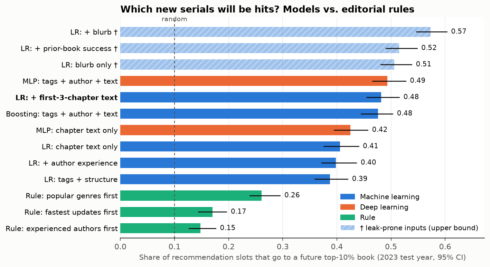

# modeling

The Project 1 main model: rule baselines → machine learning → deep learning, plus a drift test.

## How to run

Needs `embedding/out/books.parquet` and `embedding/out/watermark_books.csv`. The whole folder runs in about 3 minutes (Mac, CPU).

```bash
cd modeling
uv run python features.py     # self-check: split sizes, author history does not peek ahead, metrics are right
uv run python 01_ml.py        # rules, logistic regression, gradient boosting
uv run python 02_dl.py        # PyTorch MLP
uv run python 03_compare.py   # comparison, confidence intervals, groups, leak checks, impact
uv run python 04_drift.py     # fixed test year, training data of different ages
uv run python 05_demo_data.py # data for the demo page (docs/demo/data.js)
uv run python 06_experiments.py   # validation-year attempts to improve the main model (about 6 minutes; needs chapters.parquet)
uv run python 07_day30.py     # day-30 version: main model + first-30-day posting rhythm (needs data/interim/chapters_47.parquet and data/raw)
uv run python 08_impact.py    # business impact: hit rate and money at a fixed number of slots (needs predictions from 01, 02 and 07)
```

| File | Output |
|---|---|
| `features.py` | Shared: feature blocks, time split, metrics |
| `01_ml.py`, `02_dl.py` | `out/preds_*.parquet` (every model's score for every book, not in git), `out/selection_*.json` (chosen hyperparameters and validation scores) |
| `03_compare.py` | `out/results.json`, `out/results.md`, `out/figs/model_comparison.png` |
| `04_drift.py` | `out/drift_auc.json`, `out/figs/drift_auc.png` |
| `05_demo_data.py` | `../docs/demo/data.js`: every 2023 and 2024 book's score under each model, with title, tags, cover URL, genre tint and outcome; 20 serials per 2016 quarter and each quarter's hit threshold for the target animation; tag and warning lists; the hyperparameter grids from `selection_*.json`; two example first-three-chapter vectors and the hit direction (2017–2022, no watermarks); a 4,000-serial PCA/UMAP sample with yearly paths and the 1,536-d 2017→2024 shift cosine; screen 0's numbers (including the hits' share of 2023 views and followers) and cover wall; the top pick's first lines (≤ 200 characters, from `atlas.parquet`) with their cl100k_base tokens and its chapter-1 vector; two standardized raw dimensions of the map sample; the cover model's scores from `cover/out/preds_cover.parquet` when present (checked against `cover_merge.json`); views per serial for the business screen; the drift, tag-lift and cover-experiment numbers the page charts. Prints the 50-slot numbers and the ad revenue used in the deck |
| `06_experiments.py` | `out/experiments_val.json` (stylometric features cached in `out/style_trainval.parquet`, not in git) |
| `07_day30.py` | `out/day30.json`, `out/preds_day30.parquet` (not in git) |
| `08_impact.py` | `out/impact.json` (the deck and video read their numbers from here) |

## Design

- **Unit**: one book per row, from `embedding/out/books.parquet` (45,245 books first released 2016–2024 with at least 3 chapters).
- **Y**: `top10`, whether followers are at or above the 90th percentile among books first released in the same quarter. Comparing within the quarter removes the "older books have more followers" effect.
- **Split (by time)**:

| | Years | Books | Use |
|---|---|---|---|
| train | 2017–2021 | 17,100 | Training |
| val | 2022 | 5,700 | Hyperparameters and choosing the main model |
| test | 2023 | 8,075 | Scored once at the end |
| recent | 2024 | 12,165 | Supplementary. Observed for only 0.5–1.5 years, so its top 10% is not settled |

  2016 is not used (75% of its books carry watermarks). After tuning, models are refit on 2017–2022 and scored on 2023 and 2024. An author's older book in train and newer book in test is allowed: in production the author's earlier books are visible too.

- **Metrics**: AUC, AP, and **Recall@slots**. Each quarter gets as many slots as it has true hits (about 10%, roughly 203 a quarter in 2023); Recall@slots is the share of those slots that go to a true hit. Random picks score 0.10.
- **Feature blocks** (the letters appear in model names, e.g. `lr_SAT`):

| Code | Content | Dims | Usable? |
|---|---|---|---|
| S | tags, warnings, `is_original`, length of chapters 1–3 and days between them | 75 | Yes |
| A | author experience: first book or not, number of earlier books | 2 | Yes |
| T | first-three-chapter vector `book_vec` | 1,536 | Yes |
| P | whether an earlier book reached its quarter's top 10% | 1 | **Leak-prone**: earlier books' followers are a 2025 snapshot, and a new hit pulls readers back to them |
| D | blurb vector `desc_vec` + blurb length | 1,537 | **Leak-prone**: the blurb is the 2025 version, see below |

  Not usable as features (only known afterwards): `followers`, `total_views`, `average_views`, `favorites`, `ratings`, `n_chapters`, `pct_in_quarter`, `log_followers`, `status`, `cover_url`. Raw follower counts of earlier books are not used either.

- **The main model is not chosen on test scores**: among the three leak-free candidates (`lr_SAT`, `gb_SAT`, `mlp_SAT`) the one with the highest validation AUC wins, which is `lr_SAT`.

## Results (2023 test year, 8,075 books, 811 hits)



| Model | AUC | Recall@slots (95% CI) | 2024 |
|---|---|---|---|
| Rule: fastest updates first | 0.625 | 0.170 (0.144–0.196) | 0.195 |
| Rule: experienced authors first | 0.565 | 0.148 (0.127–0.176) | 0.177 |
| Rule: popular genres first | 0.742 | 0.261 (0.239–0.295) | 0.282 |
| LR: S | 0.810 | 0.387 (0.359–0.420) | 0.405 |
| LR: S+A | 0.814 | 0.398 (0.372–0.436) | 0.414 |
| **LR: S+A+T (main)** | **0.887** | **0.482 (0.455–0.515)** | 0.453 |
| Gradient boosting: S+A+T | 0.865 | 0.476 (0.445–0.503) | 0.470 |
| MLP: S+A+T | 0.886 | 0.493 (0.466–0.527) | 0.456 |
| LR: T only | 0.856 | 0.406 (0.376–0.440) | 0.377 |
| MLP: T only | 0.858 | 0.425 (0.395–0.457) | 0.388 |
| LR: S+A+T+P † | 0.896 | 0.515 (0.491–0.548) | 0.490 |
| LR: S+A+T+P+D † | 0.918 | 0.573 (0.547–0.603) | 0.566 |
| LR: D only † | 0.873 | 0.506 (0.481–0.538) | 0.491 |

† Leak-prone; upper bound only. Full numbers in `out/results.json`.

**What each step adds** (Recall@slots, percentage points, paired bootstrap 95% CI):

| Comparison | Difference | 95% CI | Reading |
|---|---|---|---|
| Main model vs best rule | +22.1 | +18.2 to +25.3 | Model clearly beats the rule |
| Add author experience (S → S+A) | +1.1 | −0.2 to +3.0 | Not significant |
| Add chapter text (S+A → S+A+T) | +8.4 | +4.8 to +11.2 | Significant: the text helps |
| Gradient boosting vs LR | −0.6 | −3.8 to +1.8 | No difference |
| MLP vs LR | +1.1 | −0.8 to +2.8 | No difference |
| Add earlier books' success († P) | +3.3 | +1.5 to +5.5 | Significant, but leak-prone |
| Add blurb († D) | +5.8 | +3.2 to +8.5 | Significant, but leak-prone |

**By author group** (main model `lr_SAT`):

| Group | Books | AUC | Recall@slots | Best rule |
|---|---|---|---|---|
| All | 8,075 | 0.887 | 0.482 | 0.261 |
| First-time authors | 5,383 | 0.878 | 0.430 | 0.246 |
| Returning authors | 2,692 | 0.894 | 0.536 | 0.317 |

First-time authors are harder to call, but the model still beats the rule by a wide margin.

**Impact** (2023: about 2,019 new books and 203 slots per quarter on average):

| Ranking | Future hits per quarter | Eventual followers of the picks |
|---|---|---|
| Random | 20 | about 42k |
| Popular genres first | 53 | about 118k |
| Main model | 98 | about 238k |
| Perfect foresight | 203 | about 372k |

Followers are an after-the-fact number, used only to show whether slots went to the right books; they are not an effect caused by recommending.

**Who got the slots the model missed** (`06_experiments.py` part 6; descriptive only, not used to choose a model): 48.2% of the main model's slots go to books in their quarter's top 10% and 67.4% to the top 20%; the misses have a median rank at the quarter's 76th percentile. For the popular-genres rule the numbers are 26.1%, 42.5% and the 65th percentile; for random picks, 10%, 20% and the 50th percentile.

## Day-30 version (`07_day30.py`)

A second pass for the recommendation team: recommend a first batch at chapter 3, then re-rank on day 30 after chapter 1 using posting rhythm. Features are the main model's S+A+T plus V: chapters posted on day 1, in the first 7 days and in the first 30 days, days with an update in the first 30 days, the longest gap, days since the last update at day 30, and total characters in the first 30 days. V only uses chapters released in the first 30 days (source `data/interim/chapters_47.parquet`), all visible on day 30.

In the training and validation years, future hits post a median of 15 chapters in their first 30 days; other books post 6.

| | Chapter 3 (`lr_SAT`) | Day 30 (S+A+T+V) | Difference (pp, paired bootstrap 95% CI) |
|---|---|---|---|
| Validation 2022, Recall@slots | 0.454 | 0.506 | |
| Test 2023, all | 0.482 | 0.490 | +0.7 (−2.0 to +3.1), not significant |
| Test 2023, first-time authors | 0.430 | 0.455 | +2.4 (−1.1 to +6.4), not significant |
| 2024, all | 0.453 | 0.516 | |
| 2024, first-time authors | 0.383 | 0.464 | |

It looks useful on the validation year (+5.2) but only +0.7 remains on the 2023 test year. 2024 gains another 6.3, but 2024 books have the shortest observation time (0.5–1.5 years): their followers still mostly reflect the first few months, which posting rhythm naturally tracks, so the 2024 gain is probably overstated. Conclusion: use it as a confirmation pass, A/B test before launch, and do not replace the chapter-3 main model.

A full author history (F: recomputed from all books, including earlier books abandoned before chapter 3 and books before 2016) was compared on the validation year only: Recall@slots 0.454 → 0.462, no change for first-time authors. Of the authors labelled first-time, 5.3% had in fact written before (earlier books with fewer than 3 chapters or before 2016). The effect is small; not adopted.

Known risks: books that get stubbed after succeeding usually keep their first few dozen chapters, so the first 30 days are mostly intact and the effect is conservative; authors of unsuccessful books who delete chapters would make their rhythm look worse than it was, which this dataset cannot detect. In production, authors could split chapters to inflate counts, which is why character count is a feature.

## Business impact (`08_impact.py`)

The deck's version: a fixed 50 recommendation slots per quarter (Rising Stars shows at most 50 serials per genre), filled with the 50 highest scores each quarter. This differs from Recall@slots above, where slots = the quarter's number of hits (about 203 per quarter in 2023). All assumptions sit at the top of `08_impact.py`; after changing them, rerun 08 and `reports/slides/build_deck.js`.

2023 test year, 50 slots per quarter:

| Ranking | Share of slots that are hits (95% CI) | Hits per quarter |
|---|---|---|
| Random | 10% | 5 |
| Rule: popular genres first | 28% (22%–35%) | 14 |
| LR: S+A | 53% (46%–60%) | |
| **LR: S+A+T (main)** | **68% (61%–75%)** | **34** |
| Gradient boosting: S+A+T | 71% (63%–77%) | |
| MLP: S+A+T | 74% (65%–78%) | |

Chapter text adds +15.5 points (CI +7.5 to +23.5). MLP over LR is +5.5 (CI −2.0 to +9.8) and boosting +3.0, neither significant in 2023, so the main model stays LR. A post-hoc look with 2024 pooled in (8 quarters): MLP +6.2 (CI +1.0 to +9.3), boosting +5.2 (CI −0.7 to +10.1). The MLP may really add a few points at the very top of the list, but 2024 labels are immature and this comparison was made after seeing the results, so it only counts as a reason to compare again at each yearly retrain (`diff_pp_2023_2024` in `impact.json`). The fewer the slots, the larger the gap between model and rule: the slot picks' cumulative views are 7.7x the rule's at 25 slots per quarter, 5.5x at 50, 2.3x at 200 and 1.7x at 400.

Money (base case: a slot lifts that serial's views by 10%; $3 of ad revenue per 1,000 views): the model's slots bring about 13 million extra views and about $39k a year; lift 5–20% and CPM $2–5 give a range of $13k to $130k. This only counts giving the same slots to the right serials, not readers staying on to read other serials, so it is conservative. In 2023 the quarter's top 10% took 86% of all views, which is also why "hit" is defined as the top 10%.

Supplementary: if an editor needs 10 minutes per serial and, with the model, reads only the top 200 each quarter, that saves about 1,200 hours a year (about $36k at $30 an hour). This is what makes human review feasible, not money Royal Road spends today.

`impact.json` also lists examples for the video opening: 2023 first-time authors whose serials later reached the top 10% and that the model already ranked in the quarter's top 50 at chapter 3 (the first is "Reborn as a Demonic Tree": ranked 31st of 1,775 in 2023Q1, now 15,595 followers).

## Drift (`04_drift.py`)


Fix the test year and train on data of different ages (2-year windows, 5,000 books each). Within the same test year, each extra year of training-data age costs:

- Tags and other structured features only: 0.026 AUC.
- First-three-chapter text only: 0.008 AUC.

Rules built on tags go stale fast; the text signal lasts longer. Part of the tags decline is the tagging system itself changing (Progression, for example, only became common later), not only reader taste. Recommendation for the team: retrain at least once a year.

## Leak checks

- **The blurb (D) leaks.** In the test year, 7.8% of blurbs mention Amazon, Kindle, Patreon, Audible, "Book 2" or Discord. 45.5% of those books are hits (10% overall), and the flag alone has an AUC of 0.652. Authors mostly add these words after a book takes off, so D stays out of the main model. Dropping those books lowers the blurb-only model's AUC from 0.873 to 0.837.
- **Watermarks do not affect the model.** 9.7% of test books contain watermarks; 11.1% of them are hits (about the overall rate), and the flag alone has an AUC of 0.506. Dropping them gives a main-model AUC of 0.889 (was 0.887), so there is no need to redo the embeddings for modeling.
- **Not ruled out**: tags and chapter text are also 2025 versions, and authors may have edited them later (added tags, author notes in chapters). This dataset cannot recover the earlier versions.

## Validation-year experiments (`06_experiments.py`, 2026-11-16)

Attempts to improve the main model. **All compared on the 2022 validation year only** (trained on 2017–2021); the 2023 test year was not touched, so these numbers cannot be compared directly with the test-year results above. 2022 has 571 hits, so Recall@slots has a standard error of about 0.02; differences smaller than that count as no difference. Full numbers in `out/experiments_val.json`.

The baseline is the main model `lr_SAT`: validation AUC 0.8775, Recall@slots 0.454.

| Attempt | How | Validation AUC | Recall@slots | Conclusion |
|---|---|---|---|---|
| Larger embedding | Keep only the first k dimensions of `book_vec` as a smaller model (v3 embeddings can be truncated) to see the marginal value of dimensions. Text only: 512-d 0.839, 1,024-d 0.846, 1,536-d 0.849 | | | The marginal gain is already small; `text-embedding-3-large` (3,072-d, 6.5x the price) would add an estimated 0.005–0.015 AUC. Not done |
| Chapters side by side | The three chapter vectors as separate features (3 x 1,536 = 4,608 columns) instead of their mean | 0.869 | 0.427 | Worse. Three times the columns needs stronger regularization, and the differences between chapters are mostly noise |
| Chapter 1 only | The chapter-1 vector instead of the three-chapter mean | 0.867 | 0.431 | Worse. Text only: chapters 1, 2 and 3 each score about 0.82, the three-chapter mean 0.85 |
| Chapter 1 next to the mean | S+A+T+chapter 1 | 0.875 | 0.450 | No difference |
| **Equal-weight chapter mean** | Plain mean of the three chapter vectors (currently weighted by tokens) | **0.881** | **0.461** | The only small win, better at every C. With token weights a very long chapter dominates the book vector |
| Neighbour features (kNN) | The 50 most similar books that started at least 365 days earlier and have a different author: share in the top 10%, mean rank, weighted share | 0.878 | 0.457 | No difference. They carry signal alone (AUC 0.756; S+A+neighbours 0.843), but T already covers it |
| Stylometry | 17 statistics from the raw text of chapters 1–3 (sentence and paragraph length, dialogue share, `[ ]` status boxes, lowercase "i", dashes, -ly adverbs, vocabulary richness and more) | 0.877 | 0.452 | No difference. AUC 0.660 alone, helps on top of S+A (0.818 → 0.826), not on top of the main model |
| Continuous target | Ridge on the quarter rank `pct_in_quarter` instead of 0/1 | 0.861 | 0.431 | Worse. The model is pushed to separate the lower ranks that slots never use |
| Ridge on 0/1 | Control: only swaps log loss for squared error | 0.875 | 0.457 | No difference |
| Pairwise ranking loss (hit vs non-hit) | Within each quarter, pair one hit with one non-hit and let LR learn which ranks higher (a linear RankNet); mean of 3 random pairings | 0.875 | 0.467 | +1.3 points of recall but within noise (0.457–0.475 across the three), slightly lower AUC; not adopted |
| Pairwise ranking loss (by rank) | Pairs of books whose quarter ranks differ by at least 0.2 | 0.854 | 0.410 | Worse, for the same reason as the continuous target |

Among the stylometric features alone, the strongest are frequent dashes (AUC 0.605), -ly adverbs (0.586) and `[ ]` game status boxes (0.581); books with more lowercase "i" are less likely to become hits (0.468).

**Conclusion**: with the information available, the main model is close to its ceiling. More dimensions, separate chapters, neighbours and stylometry are all covered by the three-chapter vector, and changing the target or loss gives no reliable gain. The only candidate is the equal-weight chapter mean (AUC +0.003, recall +0.7 points, both within noise), not yet applied to the main model. Going further needs a different kind of information (an LLM rating the opening, or a fine-tuned text model).

## Known limitations

- On the deep learning side the text encoder is frozen; only the MLP on top is trained, and it does no better than LR. Going further would mean fine-tuning a text model (`chapters.parquet` has the text), an order of magnitude more expensive.
- Author experience counts only books in the sample (2016–2024, at least 3 chapters); earlier books, or books with fewer than 3 chapters, are not counted.
- A teammate's earlier version (2021–2023, at least 5 chapters, 13,998 books) reported Recall@10% of about 50% using titles and blurbs. Here it is 48% without blurbs and 57% with them, the same order of magnitude, but the samples and splits differ, so the numbers are not directly comparable.
- 2016–2017 have only 52–60 top-10% books per quarter; books with 0 followers tie in the within-quarter ranking.
- Gradient boosting is not exactly reproducible across machines: tiny floating-point differences in the PCA step change which of four near-tied settings wins on 2022. Rerun on another machine (Apple M5 Pro, scikit-learn 1.9.1) it picked learning rate 0.03 with 31 leaves and scored 0.465 instead of 0.476; still not better than LR. The rules, all LR models and the MLP reproduce exactly.
- The editors' rule has many tied scores (books with the same tags score the same), so its hit count can move by one book with the tie-break. The demo breaks ties by book id.

## Covers

All cover experiments are in `cover/`; see `cover/README.md`. Covers show some signal among books with a valid cover in 2023 (+4.0 points) but none in 2024, and merging them into the model for all books does not help (0.482 vs 0.481), so the main model stays S+A+T. Everything we tried and decided is in `EXPERIMENTS.md` at the repo root.
